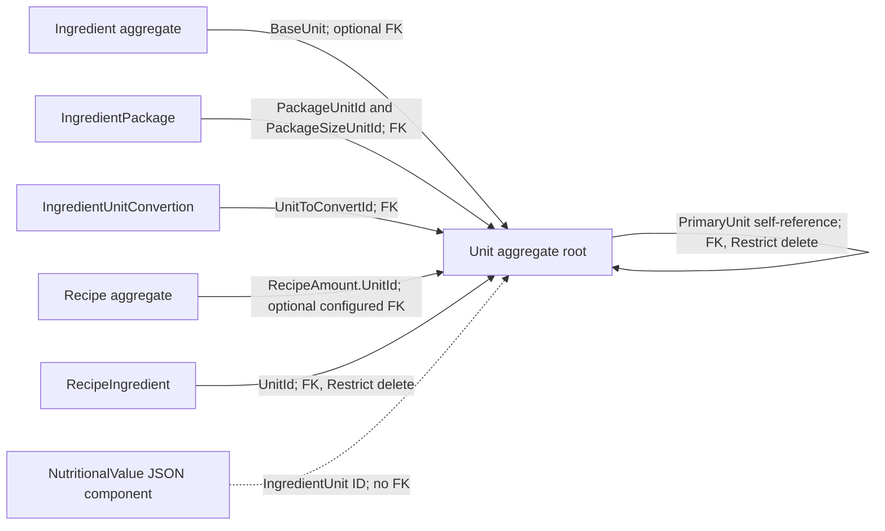

# Unit aggregate

`Unit` is a shared measurement aggregate. It defines names and abbreviations, a `UnitGroup`, and whether it is a base unit. A non-base unit can refer to a primary unit and specify a conversion factor.

## Model and relationships

- The self-reference is configured with `DeleteBehavior.Restrict`; a primary unit cannot be deleted while another unit refers to it.
- Ingredients use a unit as their optional base unit. Package units and ingredient-specific conversion units are separate references to units.
- Recipe yield amounts and recipe ingredient lines also refer to units. `NutritionalValue.IngredientUnit` is stored in the component's JSON and is not configured as a relational foreign key.
- These references do not make `Unit` part of the Ingredient or Recipe aggregate. The unit remains a separately managed shared entity.

## Persistence

`AppDbContext.Units` exposes the root set. EF maps units to `Unit`; the self-reference and references from other entities are configured in `Persistance/Configuration/Units/UnitsConfiguration.cs` and the corresponding ingredient and recipe configurations.

## Source

- `RecipeManager.API/Domain/Units/Unit.cs`
- `RecipeManager.API/Persistance/Configuration/Units/UnitsConfiguration.cs`
- `RecipeManager.API/Persistance/Configuration/Ingredients/IngredientConfiguration.cs`
- `RecipeManager.API/Persistance/Configuration/Ingredients/IngredientPackageConfiguration.cs`
- `RecipeManager.API/Persistance/Configuration/Ingredients/IngredientUnitConversionConfiguration.cs`
- `RecipeManager.API/Persistance/Configuration/Recipes/RecipeConfiguration.cs`
- `RecipeManager.API/Persistance/Configuration/Recipes/RecipeIngredientConfiguration.cs`
