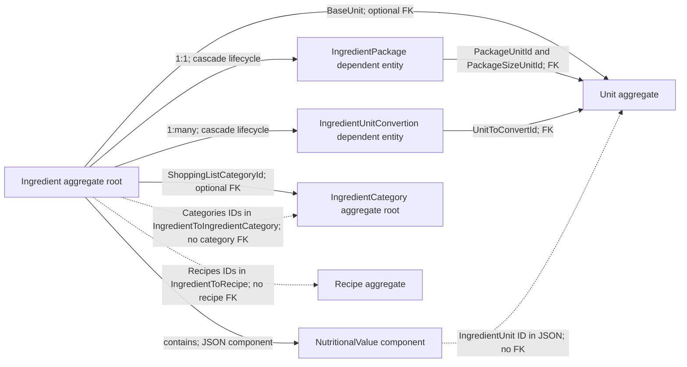

# Ingredient and IngredientCategory aggregates

`Ingredient` and `IngredientCategory` are separate aggregate roots. Ingredients carry product, nutrition, purchasing, measurement, and recipe-link information. Categories classify ingredients; they are not children owned by an ingredient.

## Model and relationships

### Ingredient

- `NutritionalValue` is a complex component serialized as JSON. Its `IngredientUnit` is an ID value in that JSON, not a configured foreign key.
- `BaseUnit` is an optional FK to `Unit`. `IngredientPackage` is a one-to-one dependent entity with package size and two unit references. `IngredientUnitConvertion` rows store ingredient-specific ratios for alternative units.
- `Categories` is a collection of category IDs stored in `IngredientToIngredientCategory`. The mapping does not configure a foreign key to `IngredientCategory`.
- `ShoppingListCategoryId` is a separate optional FK to `IngredientCategory`. It selects a shopping-list grouping category; it is not the same relationship as the general category ID collection.
- `Recipes` stores recipe IDs in `IngredientToRecipe`. This represents recipes that produce this ingredient in the application's recipe-as-ingredient workflow. It is not configured as a foreign key to `Recipe`.

### IngredientCategory

`IngredientCategory` has its own ID and name and is managed independently. An ingredient can reference multiple categories through `Categories` and optionally one shopping-list category through `ShoppingListCategoryId`.

### Recipe/ingredient direction

The model also has an optional `Recipe.IngredientId` FK to the ingredient produced by that recipe. That is a distinct persisted reference from `Ingredient.Recipes`. The API accepts both sides in their respective write models, but the domain classes do not synchronize the two collections automatically; application writes must keep them consistent when the use case requires that.

## Persistence

`Ingredient` and `IngredientCategory` are separate `AppDbContext` sets. Ingredient packages and conversions have dependent tables and cascade with their ingredient; category and recipe ID collections are stored in separate tables without configured FKs to the referenced aggregate roots.

## Source

- `RecipeManager.API/Domain/Ingredients/Ingredient.cs`
- `RecipeManager.API/Domain/Ingredients/IngredientCategory.cs`
- `RecipeManager.API/Domain/Ingredients/IngredientPackage.cs`
- `RecipeManager.API/Domain/Ingredients/IngredientUnitConvertion.cs`
- `RecipeManager.API/Persistance/Configuration/Ingredients/IngredientConfiguration.cs`
- `RecipeManager.API/Persistance/Configuration/Ingredients/IngredientCategoryConfiguration.cs`
- `RecipeManager.API/Persistance/Configuration/Ingredients/IngredientPackageConfiguration.cs`
- `RecipeManager.API/Persistance/Configuration/Ingredients/IngredientUnitConversionConfiguration.cs`
- `RecipeManager.API/Features/Ingredients/CreateIngredient.cs`
- `RecipeManager.API/Features/Recipes/CreateRecipe.cs`
