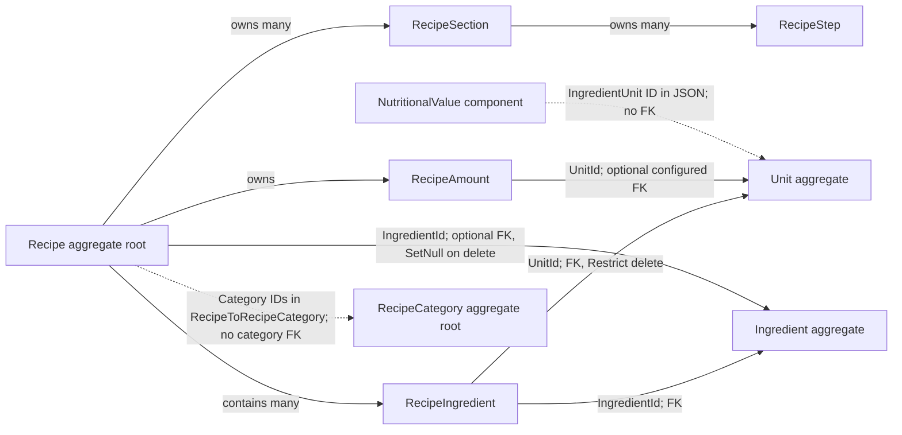

# Recipe and RecipeCategory aggregates

`Recipe` and `RecipeCategory` are separate aggregate roots. A recipe owns its preparation details and recipe-ingredient lines. Categories are independently managed classification records; a recipe stores their IDs rather than category entities.

## Model and relationships

### Recipe

- `RecipeAmount` holds the yield quantity and unit ID. It is owned by the recipe; EF maps its amount on the recipe row and configures a unit reference.
- `Sections` and their `Steps` form a nested owned structure persisted in `RecipeSection` and `RecipeSectionStep`.
- Each `RecipeIngredient` line records an `IngredientId`, `UnitId`, and amount. Its `RecipeId` FK cascades with the recipe; the ingredient reference uses `ClientCascade`, and the unit FK restricts unit deletion.
- `IngredientId` on `Recipe` is optional and identifies the ingredient produced by the recipe. Its FK is set null if that ingredient is deleted.
- Recipe nutrition is a JSON component. The embedded nutrition unit ID is not a configured FK.

### RecipeCategory

`RecipeCategory` has its own ID, name, and `RecipeCategoryType`. Recipe category IDs are stored in `RecipeToRecipeCategory`; the mapping does not configure FKs to category rows. Categories are therefore independent roots rather than children of a recipe.

## Persistence

`AppDbContext` exposes both `Recipes` and `RecipeCategories`. Recipe detail rows and ID collections are configured in `Persistance/Configuration/Recipes/`; the category root maps to `RecipeCategory`.

## Source

- `RecipeManager.API/Domain/Recipes/Recipe.cs`
- `RecipeManager.API/Domain/Recipes/RecipeCategory.cs`
- `RecipeManager.API/Domain/Recipes/RecipeIngredient.cs`
- `RecipeManager.API/Domain/Recipes/ValueObjects/RecipeAmount.cs`
- `RecipeManager.API/Domain/Recipes/ValueObjects/RecipeSection.cs`
- `RecipeManager.API/Domain/Recipes/ValueObjects/RecipeStep.cs`
- `RecipeManager.API/Persistance/Configuration/Recipes/RecipeConfiguration.cs`
- `RecipeManager.API/Persistance/Configuration/Recipes/RecipeCategoryConfiguration.cs`
- `RecipeManager.API/Persistance/Configuration/Recipes/RecipeIngredientConfiguration.cs`
