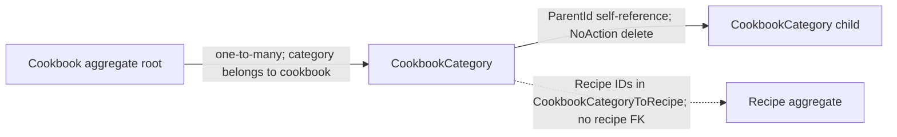

# Cookbook aggregate

`Cookbook` is the aggregate root for a user's cookbook structure. A cookbook contains categories, which can be nested into subcategories. Categories hold recipe IDs, not recipe entities.

## Model and relationships

- `Cookbook` contains its `CookbookCategory` collection. A category has a cookbook navigation, tying it to its root.
- `CookbookCategory.ParentId` provides the category hierarchy. The self-reference uses `DeleteBehavior.NoAction` to avoid cascading through a recursive tree.
- Categories store recipe IDs in `CookbookCategoryToRecipe`. This is a conceptual many-to-many association; the mapping does not configure a foreign key to `Recipe`.
- A recipe can therefore be referenced by categories in multiple cookbooks without being owned by any cookbook.
- Cookbook ownership is associated with the current user through the auditable `CreatedBy` field. Cookbook queries filter by the current user's ID; there is no user entity navigation in this domain model.

## Persistence

`Cookbook` and `CookbookCategory` are exposed by `AppDbContext`. EF maps the root/category relation and recursive parent relation in `Persistance/Configuration/Cookbooks/`. Recipe references are stored as owned ID values.

## Source

- `RecipeManager.API/Domain/Cookbooks/Cookbook.cs`
- `RecipeManager.API/Domain/Cookbooks/CookbookCategory.cs`
- `RecipeManager.API/Persistance/Configuration/Cookbooks/CookbookConfiguration.cs`
- `RecipeManager.API/Persistance/Configuration/Cookbooks/CookbookCategoryConfiguration.cs`
- `RecipeManager.API/Features/Cookbooks/GetCookbooks.cs`
