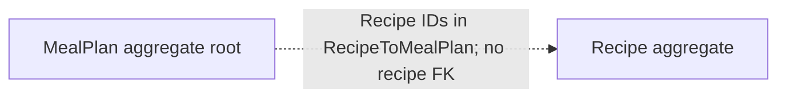

# MealPlan aggregate

`MealPlan` is a user-scoped aggregate for one planned date and its collection of recipes. It does not model meal slots such as breakfast or dinner.

## Model and relationships

- The plan stores its date as `DateTimeOffset` and its recipe IDs as a collection.
- EF persists the recipe ID collection in `RecipeToMealPlan`; the mapping does not configure a foreign key to `Recipe`. The plan references recipes but does not own them.
- Meal plans are scoped to the current user using the auditable `CreatedBy` field in the read feature. The domain model does not contain a user navigation.
- The configuration does not declare a unique date constraint; the model alone does not guarantee exactly one plan per user/date.

## Persistence

`AppDbContext.MealPlans` exposes the root set. The root maps to `MealPlans`; recipe ID values are stored in `RecipeToMealPlan`.

## Source

- `RecipeManager.API/Domain/MealPlan/MealPlan.cs`
- `RecipeManager.API/Persistance/Configuration/MealPlanner/MealPlanConfiguration.cs`
- `RecipeManager.API/Features/MealPlanner/GetMealPlan.cs`
