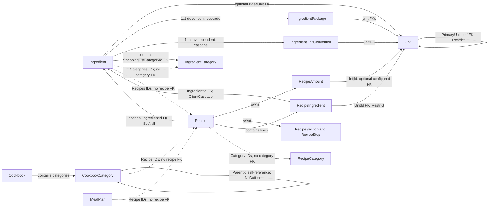

# Aggregate relationships

This page summarizes the aggregate boundaries and cross-aggregate references in the RecipeManager domain. Solid arrows indicate configured relational relationships; dashed arrows indicate IDs held as values without a configured FK to the target aggregate. Composition arrows show content managed with its owning root.

## Boundary summary

| Aggregate root | Content managed with the root | References to other aggregates |
| --- | --- | --- |
| `Unit` | Unit data and its optional primary-unit reference | Referenced by ingredient, recipe, and package/conversion data |
| `Ingredient` | Nutritional JSON component, package, unit conversions, and stored ID collections | Optional base unit; optional shopping-list category; recipe IDs |
| `IngredientCategory` | Category name | Referenced by ingredient IDs |
| `Recipe` | Yield amount, sections/steps, recipe-ingredient lines, and category ID collection | Ingredients, units, output ingredient, and recipe categories |
| `RecipeCategory` | Category name and type | Referenced by recipe IDs |
| `Cookbook` | Cookbook categories and their subcategory tree | Recipe IDs stored on cookbook categories |
| `MealPlan` | Date and recipe ID collection | Recipe IDs |

## Relationship notes

- Recipe and ingredient-category membership, cookbook recipe placement, meal-plan recipe selection, and `Ingredient.Recipes` are ID collections stored in owned tables. Their target IDs are not configured as FKs to the target aggregate tables.
- `RecipeIngredient` is different: it is a dependent row owned by a recipe, with configured foreign keys to its ingredient and unit. The recipe output `IngredientId` is also a configured FK, separate from the ID collection on `Ingredient`.
- `IngredientCategory` has two distinct paths from `Ingredient`: the general `Categories` ID collection and the optional `ShoppingListCategoryId` FK used for shopping-list grouping.
- `CreatedBy` on auditable roots is the user ownership marker used by user-scoped features; it is a string audit value, not a relationship to an identity aggregate.

## Source

- `RecipeManager.API/Domain/`
- `RecipeManager.API/Persistance/AppDbContext.cs`
- `RecipeManager.API/Persistance/Configuration/`
- `RecipeManager.API/Features/Cookbooks/GetCookbooks.cs`
- `RecipeManager.API/Features/MealPlanner/GetMealPlan.cs`
