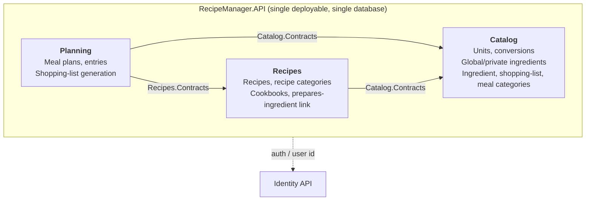
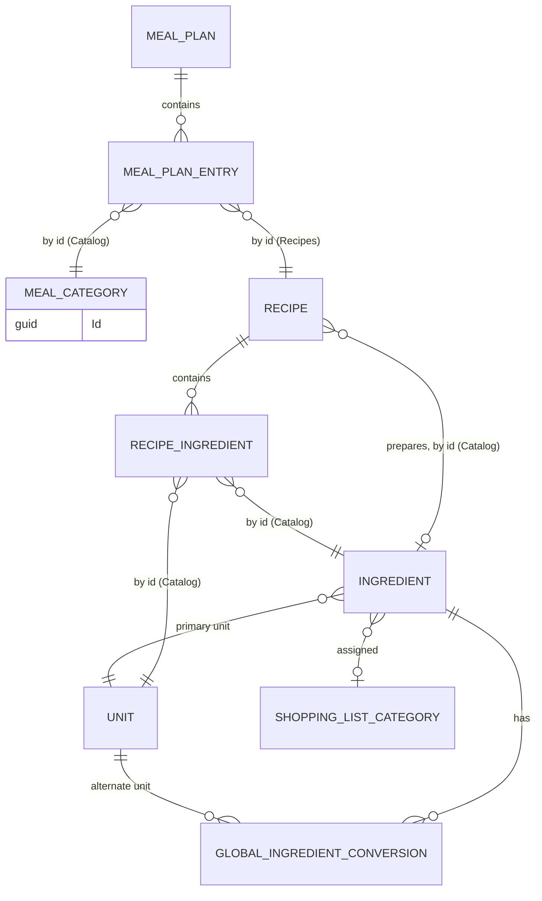
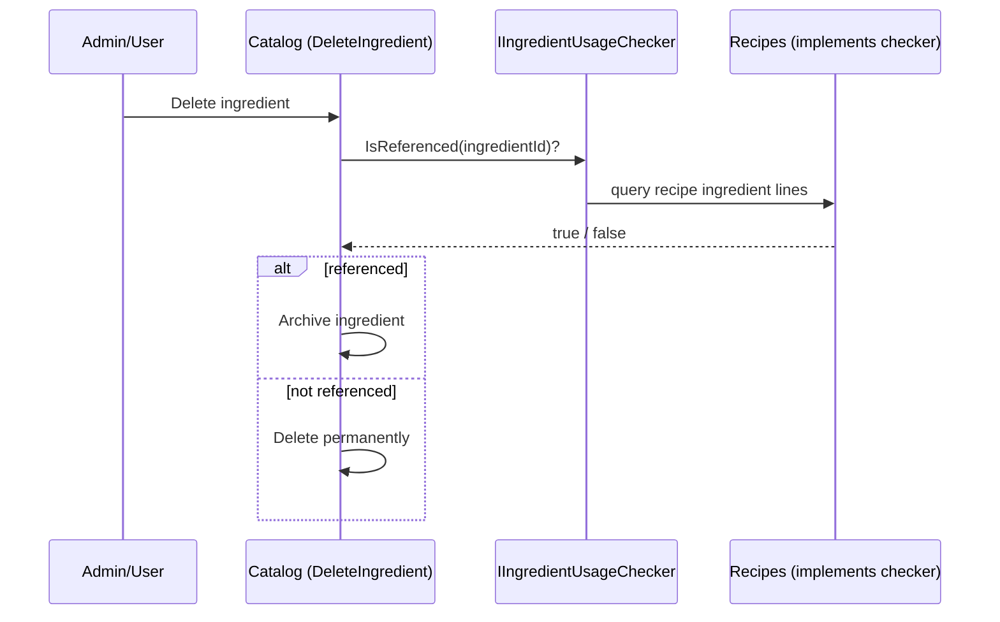
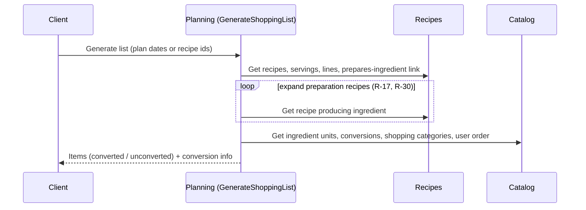

# ADR 0001: Modular monolith module boundaries

- Status: Proposed
- Date: 2026-11-18
- Related: `.work/domain-redesign/prd.md`, `wiki/domain/*`

## Context
The domain redesign (global/private ingredients, global units, categorized meal plans, on-demand shopping lists) touches most Recipe API features. We want clearer boundaries to reduce coupling, but the domain is interconnected:

- Recipe ingredient lines reference ingredients; an ingredient may be prepared by a recipe (R-17, R-30), which is circular.
- Ingredients referenced by recipes cannot be deleted, only archived (R-38).
- An ingredient without a preparation recipe requires a shopping-list category (R-04).
- Shopping-list generation reads plans, recipes, ingredients, units and conversions.

## Decision
Adopt a **modular monolith** with three modules inside `RecipeManager.API`, one deployable and **one physical database**. Identity stays a separate API.

### Modules
| Module | Owns | Depends on |
|--------|------|------------|
| **Catalog** | Units and unit groups, global ingredient conversions, global and private ingredients (incl. archive state, mapping), ingredient classification categories, shopping-list categories and per-user ordering, meal categories | nothing |
| **Recipes** | Recipes (ingredients lines, sections, steps, nutrition, output amount), recipe categories, cookbooks, the "recipe prepares ingredient" link | Catalog |
| **Planning** | Meal plans and entries, shopping-list generation (derived, not persisted) | Catalog, Recipes |

Dependencies are one-directional: Planning -> Recipes -> Catalog. No cycles.

### Data ownership and references
Each module owns its tables. References between modules are by ID (foreign keys allowed at database level).

### Breaking the Recipe/Ingredient cycle
The preparation-recipe link is owned by **Recipes** (a recipe declares which ingredient it produces). Catalog never references recipes.

### Cross-module rules
- Modules interact only through a public contracts surface (interfaces and DTOs in a `Contracts` namespace per module). Other modules must not touch a module's entities, `DbSet`s or internal handlers.
- Each module has its own DbContext/schema and its own tables. Cross-module references are by ID.
- Cross-module foreign keys: allowed at database level for Recipes -> Catalog and Planning -> Recipes/Catalog while there is a single database, to preserve integrity (notably R-38). Application code must not rely on navigation properties across modules.
- Queries spanning modules (e.g. shopping list) compose results via contracts, not joins over foreign DbSets.

### Invariants that cross boundaries
| Rule | Approach |
|------|----------|
| R-38 archive instead of delete when referenced | Catalog defines `IIngredientUsageChecker`; Recipes implements it. Catalog delete handler asks it before deleting. |
| New recipe lines cannot use archived ingredients | Recipes validates through Catalog contract (`IIngredientLookup`: exists, archived, owner/visibility, primary unit). |
| R-04 shopping category required when no preparation recipe | Validated at shopping-list generation (Planning); Catalog only stores the optional category. Revisit if this proves too late. |
| Shopping-list expansion and conversion (R-17, R-20, R-30, R-32) | Planning orchestrates via Recipes and Catalog contracts. Catalog exposes unit/ingredient conversion; Recipes exposes recipe content and preparation link. |

### Enforcement
- Architecture tests (NetArchRules) forbid references from one module's internals to another's, and forbid dependency cycles between modules.
- Features keep the existing Vertical Slice / REPR structure inside each module: `Features/<Module>/<Feature>/...`.

## Phasing
1. Implement the domain redesign first, using the module folders and contracts from the start where cheap; no new infrastructure projects.
2. Add architecture tests for boundaries once the redesigned slices exist.
3. Consider separate assemblies and schema-per-module afterwards. Splitting databases is **not** planned; it would require dropping cross-module foreign keys and handling R-38 by eventual consistency.

## Consequences
- Clearer ownership and a one-directional dependency graph.
- Some invariants become cross-module checks instead of simple foreign keys or joins.
- Extra contract surface to maintain; slightly more indirection for lookups.
- Physical database separation stays possible later but is deliberately deferred.

## Alternatives considered
- **Single module (status quo):** simplest, but coupling keeps growing.
- **Fine-grained modules (Units, Ingredients, Recipes, MealPlanner...):** Units/Ingredients and Ingredients/Recipes are too chatty and cyclic to separate usefully.
- **Separate databases per module now:** loses integrity guarantees (R-38) with no stated scale or deployment need.
