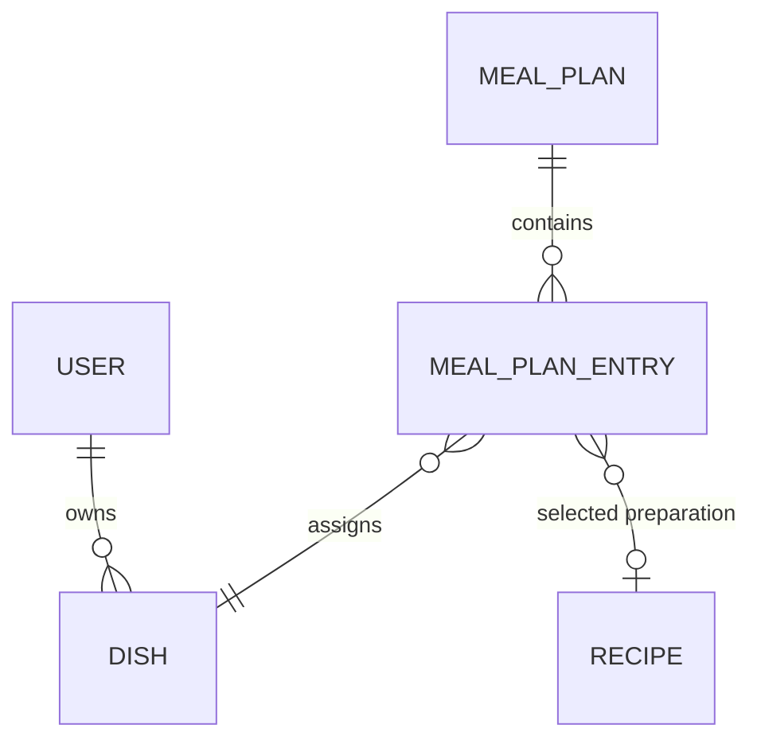

# Dishes domain

## Purpose
A Dish is a user's named, illustrated meal-planning item. It can stand alone or be prepared using one of several alternative Recipes.

## Entities and value objects
| Name | Kind (entity/value object) | Description | Key attributes |
|------|----------------------------|-------------|----------------|
| Dish | Entity | **Added:** a user-owned item that can be planned independently of a Recipe. | Owner, required name, required image URL, optional nutrition, alternative Recipes |
| Dish nutrition | Value object | Nutrition for one serving of a Dish. **Required and complete when the Dish has no associated Recipes.** | Calories, carbohydrates, fats, proteins |

Dish name length and image URL constraints are not specified.

## Relationships

- A Dish may have zero or more associated Recipes. They are alternative preparations, not components combined into the Dish.
- The reverse cardinality of the Dish–Recipe relationship is unresolved; see Open questions.
- A Meal-Plan Entry references one Dish. If that Dish has associated Recipes, the entry must identify exactly one selected Recipe.
- If a Dish has no associated Recipes, its own per-serving nutrition is used for daily nutrition calculations. Otherwise, the selected Recipe's nutrition is used.
- If nutrition is unavailable for a planned item, daily nutrition totals are marked incomplete rather than treating missing values as zero.
- A standalone Dish without a selected Recipe appears in the dedicated "Dishes" shopping-list category. Admins cannot manage this category.
- Recipe's optional main image remains separate from the required Dish image; Recipe step images remain supported. See [Recipes](recipes.md).

## Invariants and rules
| Rule | Applies to | PRD ref |
|------|------------|---------|
| Every Dish has a name and an image URL. | Dish | R-46 |
| A Dish is owned by one user. | Dish | R-39 |
| A Dish may have zero or more alternative preparation Recipes; they are not combined as components. | Dish, Recipe | R-40 |
| Dish nutrition describes one serving; a Dish without associated Recipes requires calories, protein, fat, and carbohydrates. | Dish, Dish nutrition | R-41, R-42 |
| A planned Dish with associated Recipes must select one; use the selected Recipe's nutrition for the day's calculation. | Dish, Recipe, meal-plan entry | R-43 |
| A planned Dish without associated Recipes uses its own nutrition for the day's calculation. | Dish, meal-plan entry | R-44 |
| Missing nutrition is not treated as zero; mark the day's nutrition total incomplete. | Meal-plan entry, nutrition total | R-48 |
| Recipe.ImageUrl remains optional and distinct from Dish.ImageUrl. | Recipe, Dish | R-47 |

## Lifecycle / states
Not applicable.

## Open questions
- What are the maximum Dish name length and image URL constraints?
- Can one Recipe be associated with multiple Dishes?
