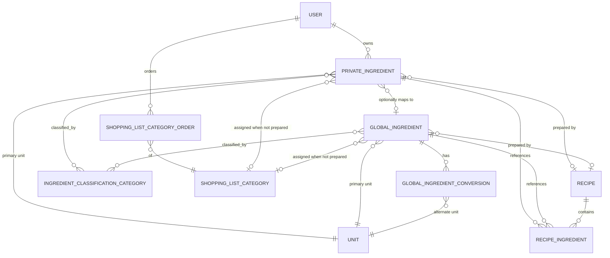

# Ingredients domain

## Purpose
The ingredient catalog contains admin-managed global ingredients and user-owned private ingredients. Ingredient classification, shopping-list grouping, and conversions are separate concerns.

## Entities and value objects
| Name | Kind (entity/value object) | Description | Key attributes |
|------|----------------------------|-------------|----------------|
| Global ingredient | Entity | Shared catalog item maintained by admins. **Changed:** explicitly global and has a required primary unit. Referenced ingredients are archived rather than deleted. | Name, primary unit, classification categories, optional shopping-list category, optional preparation recipe, lifecycle state |
| Private ingredient | Entity | User-owned ingredient. **Added:** may optionally map to a global ingredient. Referenced ingredients are archived rather than deleted. | Owner, name, optional global-ingredient mapping, primary unit, classification categories, optional shopping-list category, optional preparation recipe, lifecycle state |
| Ingredient classification category (`IngredientCategory`) | Entity | Existing ingredient taxonomy, retained separately from shopping-list categories. | Name |
| Global ingredient conversion | Entity | **Added:** admin-managed conversion from an alternate unit directly to a global ingredient's primary unit. | Global ingredient, alternate unit, conversion ratio |
| Shopping-list category | Entity | **Added:** admin-maintained global catalog for grouping ingredients on shopping lists. | Name |
| Shopping-list category order | Value object | **Added:** one user's ordering of the global shopping-list categories, independent of other users. | User, category, position |
| Preparation-recipe relationship | Relationship | An ingredient may be produced by a recipe; its shopping-list amount is expanded into that recipe's ingredients. | Ingredient, recipe |

Removed from ingredients: ingredient-level nutrition, package information, and ingredient-owned alternate-unit conversions.

## Relationships

A private ingredient mapped to a global ingredient uses the global ingredient's primary unit and conversions. Classification categories and shopping-list categories are distinct catalogs; a shopping-list category is required only when the ingredient has no preparation recipe.

## Invariants and rules
| Rule | Applies to | PRD ref |
|------|------------|---------|
| The catalog consists of admin-managed global ingredients and user-owned private ingredients. | Ingredient | R-02, R-22 |
| A private ingredient may optionally map to a global ingredient. | Private ingredient | R-03 |
| Every ingredient has a primary unit; a mapped private ingredient uses its global ingredient's primary unit. | Ingredient | R-36, R-37 |
| A mapped private ingredient uses the global ingredient's conversions; an unmapped private ingredient has no alternate-unit conversions. | Private ingredient, conversion | R-05, R-35 |
| Global ingredient conversions are admin-managed and map an alternate unit directly to that ingredient's primary unit. | Global ingredient conversion | R-05, R-07 |
| An ingredient without a preparation recipe must have a shopping-list category from the global catalog; users cannot create or modify catalog entries. | Ingredient, shopping-list category | R-04, R-25 |
| Each user orders global shopping-list categories independently. | Shopping-list category order | R-04 |
| Ingredient classification categories and shopping-list categories are separate concepts and catalogs. | Ingredient, categories | R-33 |
| Ingredients have no package information and do not store ingredient-level nutrition. | Ingredient | R-21, R-34 |
| An ingredient referenced by a recipe ingredient entry cannot be permanently deleted; archive it instead. Existing recipe references remain valid, but archived ingredients cannot be added to new recipe ingredient entries. | Ingredient, recipe ingredient | R-38 |
| An ingredient may be permanently deleted once no recipe ingredient entries reference it. | Ingredient, recipe ingredient | R-38 |

## Lifecycle / states
Ingredients may be active or archived. An ingredient referenced by a recipe ingredient entry must be archived rather than permanently deleted; its existing recipe references remain valid. Archived ingredients cannot be added to new recipe ingredient entries. Permanent deletion is allowed once no recipe ingredient entries reference the ingredient. (R-38)

## Open questions
None identified in the approved PRD for this domain.
