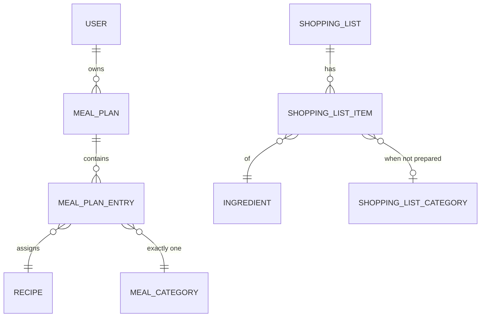

# Meal planner and shopping lists domain

## Purpose
Meal plans assign recipes to global meal categories on calendar days. Shopping lists are derived on demand from a plan or directly selected recipes.

## Entities and value objects
| Name | Kind (entity/value object) | Description | Key attributes |
|------|----------------------------|-------------|----------------|
| Meal plan | Entity | **Changed:** one user's plan for one calendar day, containing categorized recipe entries. | Owner, date-only value, entries |
| Meal-plan entry | Entity | **Added:** one assignment of a recipe to a meal category; each entry represents one serving. Multiple entries may use the same category. | Recipe, meal category |
| Meal category | Entity | **Added:** admin-maintained global catalog item (e.g. breakfast, lunch, dinner, snack). | Name |
| Shopping list | Derived result | **Changed:** generated on demand and not persisted; its source is a plan or direct recipe selection. | Items, source mode |
| Shopping-list item | Value object | An ingredient amount normalized to its applicable global primary unit when a conversion is available; otherwise retained in its original unit and marked unconverted. | Ingredient, applicable shopping-list category, amount, unit, conversion support or unconverted status |

## Relationships

Each user has exactly one meal plan per calendar date. A date has no time or timezone. Ingredients with preparation recipes expand recursively into their recipe ingredients; ingredients without preparation recipes remain shopping-list items and require a shopping-list category. Category ordering is user-specific.

## Invariants and rules
| Rule | Applies to | PRD ref |
|------|------------|---------|
| Meal categories are from an admin-maintained global catalog; regular users cannot modify it. | Meal category | R-15, R-25 |
| A plan may contain any number of entries, including multiple entries in one category; each entry has exactly one category. | Meal plan, entry | R-16, R-28 |
| Each entry represents one serving of its recipe. | Meal-plan entry | R-18 |
| Each user has exactly one plan per calendar date, and a plan date has no time or timezone. | Meal plan | R-28, R-29 |
| Plan-based lists scale saved recipe amounts by planned servings divided by saved recipe servings; each plan entry contributes one serving. | Shopping list | R-18, R-27 |
| Directly selected recipes contribute their saved amounts without scaling. | Shopping list | R-19 |
| Ingredients with preparation recipes expand recursively; each preparation recipe scales by required output amount divided by its total output amount. | Shopping list, ingredient, recipe | R-17, R-30 |
| Amounts normalize to the applicable global ingredient's primary unit when a conversion is available. If no conversion is available, retain the original amount and unit, mark it unconverted, and do not aggregate it with amounts in another unit. | Shopping-list item | R-20, R-32 |
| A mapped private ingredient uses its global ingredient's conversions; an unmapped private ingredient has no alternate-unit conversions. | Shopping-list item, ingredient | R-05, R-35, R-37 |
| Ingredients without preparation recipes require a shopping-list category from the admin-maintained global catalog; each user's category ordering is independent. | Shopping-list item, shopping-list category | R-04, R-25 |
| Shopping lists include supporting information explaining conversions used; detailed presentation is deferred. | Shopping list | R-05, R-20 |
| Shopping lists are derived on demand and are not persisted. | Shopping list | R-31 |

## Lifecycle / states
Shopping lists are derived results, regenerated on demand from a plan or direct recipe selection. Conversion support accompanies the result; its detailed presentation remains deferred.

## Open questions
None identified in the approved PRD for this domain.
