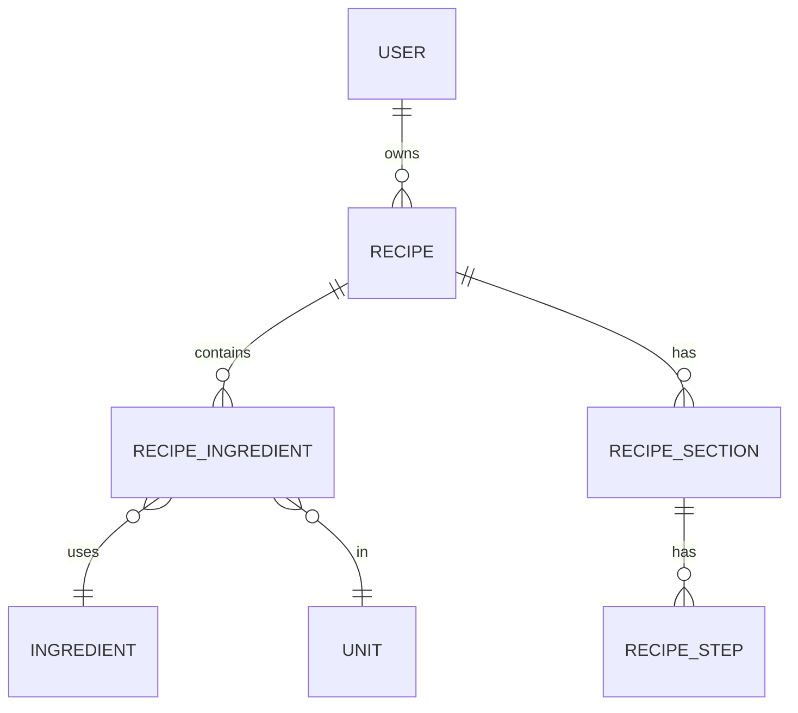

# Recipes domain

## Purpose
Recipes own their ingredient amounts, serving yield, nutrition, sections, and steps. A recipe may also prepare an ingredient, enabling shopping-list expansion.

## Entities and value objects
| Name | Kind (entity/value object) | Description | Key attributes |
|------|----------------------------|-------------|----------------|
| Recipe | Entity | **Retained:** owns recipe content, serving yield, and total output amount. Its optional main image remains separate from the required image on a Dish. Visibility, sharing, permissions, and independent copies are not introduced by this redesign. | Owner, title, description, optional main image and video URLs, difficulty, recipe categories, serving count, output amount and unit, ingredients, nutrition |
| Recipe ingredient | Entity | An ingredient line within a recipe. | Ingredient, unit, amount |
| Recipe section | Value object | A group of steps owned by a recipe. | Type, steps |
| Recipe step | Value object | An ordered preparation instruction owned by a recipe. | Order, description, image |
| Recipe nutrition | Value object | **Retained on Recipe;** ingredients do not own nutrition. | Calories, carbohydrates, fats, proteins |
| Dish preparation | Relationship | **Added:** a Recipe may be associated with a Dish as one of its alternative preparations. | Dish, Recipe |

## Relationships

An ingredient may be prepared by a recipe. Shopping-list generation expands that ingredient recursively using the preparation recipe's ingredients and output amount. Existing recipe ingredient entries may continue to reference archived ingredients, but archived ingredients cannot be added to new entries. Cookbook categories may continue to reference recipes; cookbook behavior is unchanged by the PRD.

A Recipe's optional main image is retained, and RecipeStep images remain supported. A Dish has its own required image; see [Dishes](dishes.md). Dishes associate Recipes as alternative preparations, not as components to combine.

## Invariants and rules
| Rule | Applies to | PRD ref |
|------|------------|---------|
| A recipe's saved ingredient amounts make its stated serving count; plan-based amounts scale by planned servings divided by saved serving count. | Recipe, shopping list | R-18, R-27 |
| Recipe-owned data includes the ingredient list, serving count, nutrition, sections, and steps. | Recipe | R-34; PRD §8 |
| Recipe visibility levels are not added by this redesign. | Recipe | R-13 |
| Friend sharing, sharing permissions, and independent recipe copies are not added by this redesign. | Recipe | R-14 |
| Preparation-recipe quantities scale by required prepared-ingredient amount divided by the preparation recipe's total output amount; serving count does not determine this conversion. | Recipe, ingredient, shopping list | R-30 |
| Archived ingredients remain valid in existing recipe ingredient entries but cannot be added to new entries; an ingredient referenced by any entry must be archived rather than permanently deleted. | Recipe ingredient, ingredient | R-38 |
| Recipe.ImageUrl remains optional and distinct from the required Dish image. | Recipe, Dish | R-47 |

## Lifecycle / states
Not applicable.

## Open questions
- Can one Recipe be associated with multiple Dishes?
